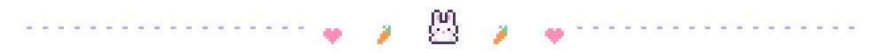
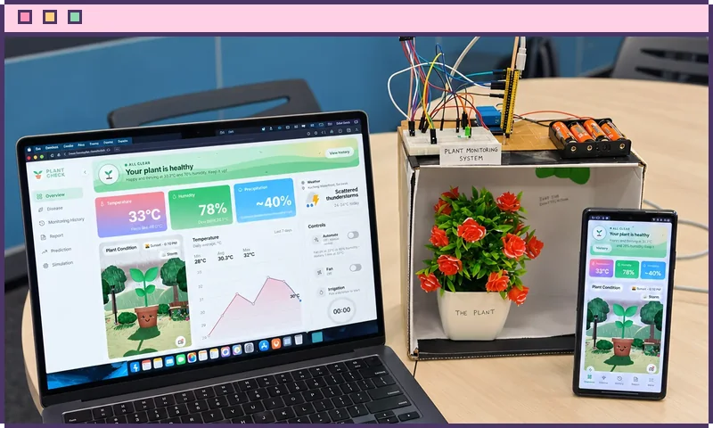
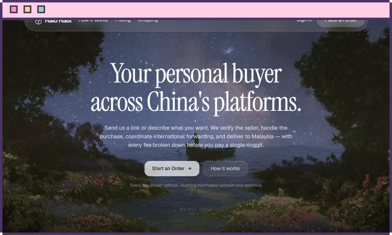
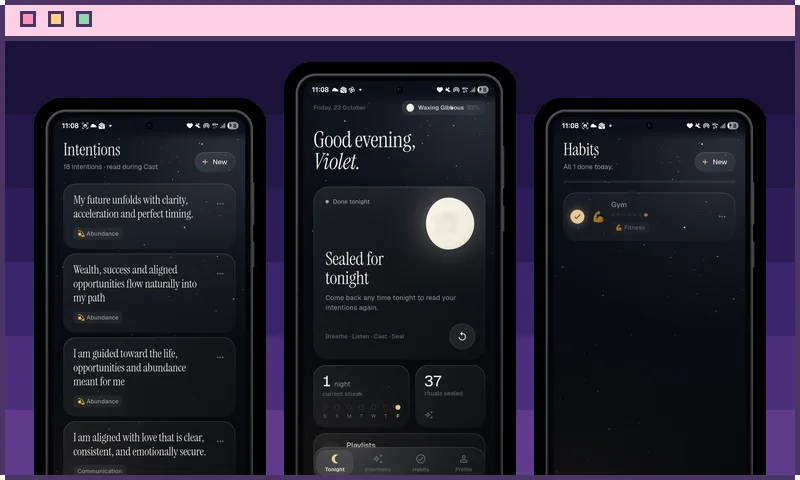
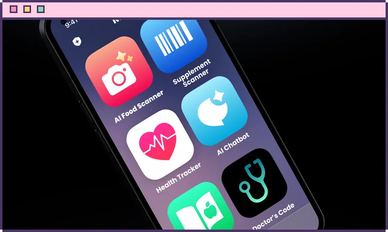
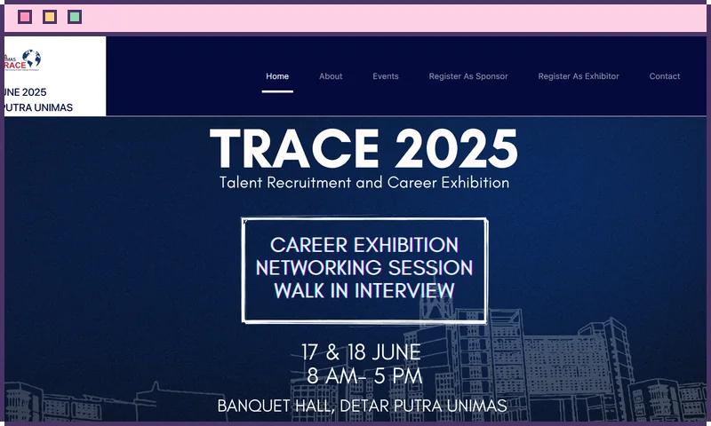
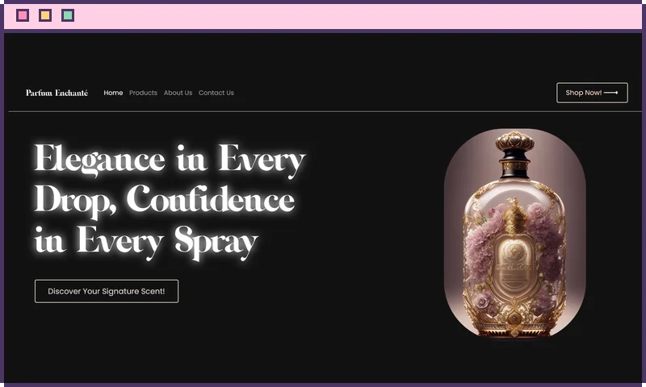

## 🥕 things I've made

<table>
<tr>
<td width="50%" valign="top">

<h3>🌱 PlantCheck</h3>
<b>🥉 3rd place, AI Hacker Dorm</b> 
An AI bodyguard for crops. It names leaf diseases from one photo, forecasts risky air an hour ahead, and runs the ventilation and irrigation by itself. I led the dashboard and wrote most of the API.
  
<kbd>Flask</kbd> <kbd>ESP32</kbd> <kbd>predictive model</kbd>  
<a href="https://plantcheck.duckdns.org">live</a> · <a href="https://putrinaqibah.com/case-studies/plant-check-iot-plant-monitor.html">case study</a>
</td>
<td width="50%" valign="top">

<h3>📦 HaloHaul</h3>
<b>a personal buyer for Malaysian students</b> 
Send a link from a Chinese marketplace, see every fee before paying, pick it up on campus. All the money maths is integer-only, because floating-point sen are a horror story.
  
<kbd>Next.js</kbd> <kbd>TypeScript</kbd> <kbd>PostgreSQL</kbd> <kbd>Docker</kbd>  
<a href="https://halohaul.com">live</a> · <a href="https://github.com/putrinaq/HaloHaul">code</a>
</td>
</tr>
<tr>
<td valign="top">

<h3>🌙 Nightly Ritual</h3>
<b>a dreamy companion for moonlit evenings</b> 
Breathe, listen, cast your intentions, then seal the night. It follows the real moon phase, obviously.
  
<kbd>Flutter</kbd> <kbd>Firebase</kbd>  
<a href="https://github.com/putrinaq/nightly_ritual">code</a>
</td>
<td valign="top">

<h3>💊 MAIA</h3>
<b>healthcare that grandma can actually use</b> 
An AI health app prototype for elderly patients, their caregivers and their doctors. 300+ hours of UX research, high contrast, voice navigation.
  
<kbd>Figma</kbd> <kbd>UX research</kbd> <kbd>accessibility</kbd>  
<a href="https://putrinaqibah.com/case-studies/maia-ai-powered-elderly-health-management-app.html">case study</a>
</td>
</tr>
<tr>
<td valign="top">

<h3>🎓 TRACE UNIMAS</h3>
<b>the career fair site that outranked the official pages</b> 
Reached 1,000+ students and #1 on Google for "UNIMAS career fair". Built over two years, with employers like EY and Public Bank on board.
  
<kbd>JavaScript</kbd> <kbd>Firebase</kbd> <kbd>SEO</kbd>  
<a href="https://putrinaqibah.com/case-studies/unimas-trace-career-platform.html">case study</a> · <a href="https://github.com/putrinaq/trace">code</a>
</td>
<td valign="top">

<h3>🌸 Parfum Enchanté</h3>
<b>RM200 in, RM500 profit out, 3 months</b> 
A student perfume shop I led with a team of six. AI did the product photos, we did the hustling, and the marketing budget was zero.
  
<kbd>JavaScript</kbd> <kbd>Bootstrap</kbd> <kbd>generative AI</kbd>  
<a href="https://parfum-enchante.web.app">live</a> · <a href="https://putrinaqibah.com/case-studies/parfum-enchante.html">case study</a> · <a href="https://github.com/putrinaq/parfum-enchante">code</a>
</td>
</tr>
</table>

## 🎀 my toolbox

**build** &nbsp; <kbd>Python</kbd> <kbd>JavaScript</kbd> <kbd>TypeScript</kbd> <kbd>React</kbd> <kbd>PHP</kbd> <kbd>Java</kbd> <kbd>C</kbd> <kbd>C++</kbd> <kbd>C#</kbd> <kbd>HTML</kbd> <kbd>CSS</kbd> <kbd>Bootstrap</kbd> <kbd>Firebase</kbd>

**design** &nbsp; <kbd>Figma</kbd> <kbd>Illustrator</kbd> <kbd>Photoshop</kbd> <kbd>Webflow</kbd> <kbd>UI/UX</kbd>

**test + automate** &nbsp; <kbd>Playwright</kbd> <kbd>UAT</kbd> <kbd>Google Cloud</kbd> <kbd>Power Automate</kbd> <kbd>Power BI</kbd>

**fix** &nbsp; <kbd>networks</kbd> <kbd>computers</kbd> <kbd>IT support</kbd> <kbd>"it was working yesterday"</kbd>

